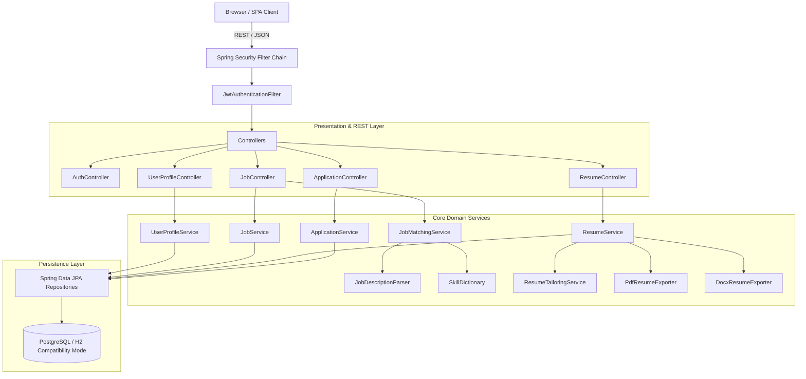

# Architecture Specification — JobFit Resume

## 1. System Overview

JobFit Resume is designed following modular monolithic architecture principles, separating concerns into distinct domain modules with loose coupling and strict data scoping.

---

## 2. Technology Stack & Architectural Decisions

| Layer | Component | Version | Decision Rationale |
|---|---|---|---|
| **Language** | Java | 21 LTS | Pattern matching, virtual threads, modern switch expressions, LTS support. |
| **Backend Framework** | Spring Boot | 3.3.4 | Spring Security 6, Jakarta Persistence, robust production ecosystem. |
| **Security** | JJWT | 0.12.6 | Stateless JWT tokens, HMAC-SHA256 signing, Bearer authorization. |
| **Document Export (PDF)** | OpenHTMLtoPDF | 1.0.10 | Pure Java, pixel-exact HTML/CSS to standard A4 PDF rendering without headless browser dependencies. |
| **Document Export (DOCX)** | Apache POI | 5.3.0 | Native Microsoft Word OOXML document generation. |
| **Database Migrations** | Flyway | 10.x | Deterministic SQL migrations across local, test, staging, and production. |
| **Frontend Framework** | React + Vite | React 19, Vite 8 | Ultra-fast HMR builds, modern hooks, modular routing. |
| **Frontend Styling** | Tailwind CSS | 3.4 | Curated HSL tokens, dark mode, responsive utility classes. |
| **API Communication** | Axios | 1.7 | Centralized request interceptors for token injection and 401 handling. |

---

## 3. Core Engine Mechanics

### 3.1. Skill Dictionary & Token Parser
The system maintains a canonical catalog of 200+ skills with regex alias recognition (`SkillDictionary`). For example:
- `k8s` -> `kubernetes`
- `postgres`, `psql` -> `postgresql`
- `react.js`, `reactjs` -> `react`
- `spring-boot`, `springboot` -> `spring_boot`

### 3.2. Explainable Weighted Matching Algorithm
When a vacancy description is analyzed:
1. **Technical & Soft Skills Match (50% weight)**: Compares required canonical skills extracted from the vacancy against the candidate's documented skills.
2. **Experience Threshold Match (25% weight)**: Regex extracts minimum years of experience and compares against candidate's cumulative work history.
3. **Education Level Match (15% weight)**: Extracts degree levels (Bachelor's, Master's, PhD) and verifies candidate records.
4. **Domain Keywords & Projects (10% weight)**: Evaluates overlap between project tech stacks and the job posting.

### 3.3. Deterministic Resume Tailoring
The tailoring engine ranks projects based on technology overlap with the job posting, prioritizes matching skills at the top of the resume, and synthesizes an aligned professional summary. Crucially, the engine is **truth-preserving**: it never fabricates false employment history or degrees.
