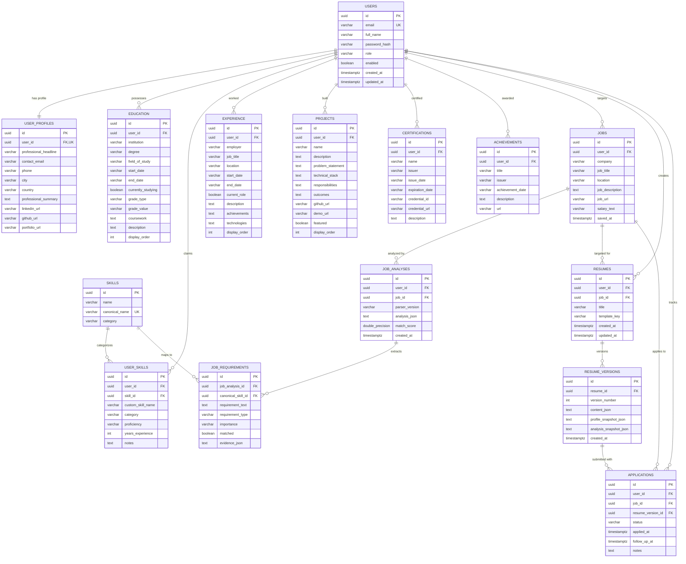

# Database Architecture & Schema Specification — JobFit Resume

## 1. Overview & Design Principles

JobFit Resume's relational data model is built for strict multi-tenant isolation, referential integrity, and transparent auditability.

Key architectural highlights:
- **UUID Primary Keys**: Every entity uses RFC 4122 Version 4 UUIDs (`UUID PRIMARY KEY`) generated client-side or server-side. This eliminates sequential ID enumeration risks and prevents cross-account enumeration attacks.
- **Tenant Scoping**: Every tenant-owned table features a non-null `user_id UUID NOT NULL` foreign key linked with `ON DELETE CASCADE` to `users(id)`.
- **Database Portability**: Schema DDL is strictly ANSI SQL compliant and runs seamlessly across local zero-dependency embedded H2 in PostgreSQL compatibility mode (`MODE=PostgreSQL`) and production managed PostgreSQL engines (AWS RDS, Neon, Supabase, Render).
- **Migration Controlled**: Schema versioning is handled exclusively via Flyway migrations (`db/migration/V1__initial_schema.sql`).

---

## 2. Entity-Relationship Diagram (ERD)

---

## 3. Detailed Table Schema Definitions

### 3.1. `users`
Core user identity for authentication and security principals.
| Column | Type | Constraints | Description |
|---|---|---|---|
| `id` | UUID | PRIMARY KEY | Unique user identifier |
| `full_name` | VARCHAR(255) | NOT NULL | User's full legal name |
| `email` | VARCHAR(255) | NOT NULL, UNIQUE | Authentication login email |
| `password_hash` | VARCHAR(255) | NOT NULL | BCrypt salted hash (strength 10) |
| `role` | VARCHAR(50) | NOT NULL, DEFAULT 'ROLE_USER' | Spring Security GrantedAuthority |
| `enabled` | BOOLEAN | NOT NULL, DEFAULT TRUE | Account active/disabled flag |
| `created_at` | TIMESTAMPTZ | NOT NULL | Record creation timestamp |
| `updated_at` | TIMESTAMPTZ | NOT NULL | Last update timestamp |

**Indexes**: `idx_users_email (email)`

---

### 3.2. `user_profiles`
1-to-1 extension containing contact info and overarching career narrative.
| Column | Type | Constraints | Description |
|---|---|---|---|
| `id` | UUID | PRIMARY KEY | Profile record ID |
| `user_id` | UUID | NOT NULL, UNIQUE, FK -> users(id) ON DELETE CASCADE | Target user reference |
| `professional_headline` | VARCHAR(255) | NULLABLE | E.g. "Senior Full-Stack Engineer" |
| `contact_email` | VARCHAR(255) | NULLABLE | Public contact email |
| `phone` | VARCHAR(50) | NULLABLE | Phone with country code |
| `city` | VARCHAR(100) | NULLABLE | City location |
| `country` | VARCHAR(100) | NULLABLE | Country location |
| `professional_summary` | TEXT | NULLABLE | Comprehensive summary paragraph |
| `linkedin_url` | VARCHAR(500) | NULLABLE | LinkedIn profile URL |
| `github_url` | VARCHAR(500) | NULLABLE | GitHub portfolio URL |
| `portfolio_url` | VARCHAR(500) | NULLABLE | Personal portfolio/blog URL |
| `created_at` | TIMESTAMPTZ | NOT NULL | Creation timestamp |
| `updated_at` | TIMESTAMPTZ | NOT NULL | Update timestamp |

**Indexes**: `idx_user_profiles_user_id (user_id)`

---

### 3.3. `education`
Academic history, degrees, coursework, and grades.
| Column | Type | Constraints | Description |
|---|---|---|---|
| `id` | UUID | PRIMARY KEY | Education record ID |
| `user_id` | UUID | NOT NULL, FK -> users(id) ON DELETE CASCADE | Target user reference |
| `institution` | VARCHAR(255) | NOT NULL | University or college name |
| `degree` | VARCHAR(255) | NOT NULL | Degree title (B.S., M.S., Ph.D.) |
| `field_of_study` | VARCHAR(255) | NULLABLE | Major or concentration |
| `start_date` | VARCHAR(50) | NULLABLE | Start date (YYYY-MM) |
| `end_date` | VARCHAR(50) | NULLABLE | End date or expected (YYYY-MM) |
| `currently_studying` | BOOLEAN | NOT NULL, DEFAULT FALSE | Ongoing enrollment flag |
| `grade_type` | VARCHAR(50) | NULLABLE | GPA, Percentage, Honors |
| `grade_value` | VARCHAR(50) | NULLABLE | Numerical or letter value |
| `coursework` | TEXT | NULLABLE | Relevant coursework list |
| `description` | TEXT | NULLABLE | Honors, societies, activities |
| `display_order` | INT | NOT NULL, DEFAULT 0 | Sorting sequence |
| `created_at` | TIMESTAMPTZ | NOT NULL | Record creation timestamp |
| `updated_at` | TIMESTAMPTZ | NOT NULL | Record update timestamp |

**Indexes**: `idx_education_user_id (user_id)`

---

### 3.4. `skills` & `user_skills`
Global canonical dictionary and user skill associations.

#### `skills` (Canonical Reference)
| Column | Type | Constraints | Description |
|---|---|---|---|
| `id` | UUID | PRIMARY KEY | Skill canonical identifier |
| `name` | VARCHAR(100) | NOT NULL | Display name (e.g., "PostgreSQL") |
| `canonical_name` | VARCHAR(100) | NOT NULL, UNIQUE | Normalized lowercase key (e.g., "postgresql") |
| `category` | VARCHAR(50) | NOT NULL | FRONTEND, BACKEND, DATABASE, CLOUD_DEVOPS, etc. |

**Indexes**: `idx_skills_canonical_name (canonical_name)`, `idx_skills_category (category)`

#### `user_skills` (User Association)
| Column | Type | Constraints | Description |
|---|---|---|---|
| `id` | UUID | PRIMARY KEY | User skill ID |
| `user_id` | UUID | NOT NULL, FK -> users(id) ON DELETE CASCADE | Target user reference |
| `skill_id` | UUID | NULLABLE, FK -> skills(id) ON DELETE SET NULL | Canonical skill match |
| `custom_skill_name` | VARCHAR(100) | NULLABLE | Custom user-defined skill |
| `category` | VARCHAR(50) | NOT NULL | Category enum |
| `proficiency` | VARCHAR(50) | NULLABLE | BEGINNER, INTERMEDIATE, ADVANCED, EXPERT |
| `years_experience` | INT | NULLABLE | Number of years practiced |
| `notes` | TEXT | NULLABLE | Contextual notes |

**Indexes**: `idx_user_skills_user_id (user_id)`

---

### 3.5. `experience`
Employment history, bullet points, and technology tags.
| Column | Type | Constraints | Description |
|---|---|---|---|
| `id` | UUID | PRIMARY KEY | Experience ID |
| `user_id` | UUID | NOT NULL, FK -> users(id) ON DELETE CASCADE | Target user reference |
| `employer` | VARCHAR(255) | NOT NULL | Company name |
| `job_title` | VARCHAR(255) | NOT NULL | Role title |
| `location` | VARCHAR(255) | NULLABLE | City, State or "Remote" |
| `start_date` | VARCHAR(50) | NULLABLE | Start date |
| `end_date` | VARCHAR(50) | NULLABLE | End date |
| `current_role` | BOOLEAN | NOT NULL, DEFAULT FALSE | Active role flag |
| `description` | TEXT | NULLABLE | Overview of responsibilities |
| `achievements` | TEXT | NULLABLE | Quantified achievements / bullets |
| `technologies` | TEXT | NULLABLE | Comma-separated tech stack |
| `display_order` | INT | NOT NULL, DEFAULT 0 | Ordering sequence |

**Indexes**: `idx_experience_user_id (user_id)`

---

### 3.6. `projects`, `certifications`, `achievements`
Portfolio highlights, verified credentials, and distinctions.

- **`projects`**: Captures problem statements, technical stacks, outcomes, and repository links. Indexed by `idx_projects_user_id`.
- **`certifications`**: Captures certification issuer, issue/expiration dates, and credential verification URLs. Indexed by `idx_certifications_user_id`.
- **`achievements`**: Captures awards, hackathon wins, publications, and patents. Indexed by `idx_achievements_user_id`.

---

### 3.7. `jobs`, `job_analyses`, `job_requirements`
Job description ingestion, automated keyword parsing, and scoring audit records.

#### `jobs`
Target vacancy descriptions pasted or submitted by the candidate. Indexed by `idx_jobs_user_id`.

#### `job_analyses`
| Column | Type | Constraints | Description |
|---|---|---|---|
| `id` | UUID | PRIMARY KEY | Analysis record ID |
| `user_id` | UUID | NOT NULL, FK -> users(id) ON DELETE CASCADE | User reference |
| `job_id` | UUID | NOT NULL, FK -> jobs(id) ON DELETE CASCADE | Associated job vacancy |
| `parser_version` | VARCHAR(50) | NOT NULL | Analysis engine version (e.g., "1.0.0") |
| `analysis_json` | TEXT | NOT NULL | Serialized full analysis payload |
| `match_score` | DOUBLE PRECISION | NOT NULL | Overall 0-100 calculated match score |
| `created_at` | TIMESTAMPTZ | NOT NULL | Analysis timestamp |

**Indexes**: `idx_job_analyses_user_id (user_id)`, `idx_job_analyses_job_id (job_id)`

#### `job_requirements`
Granular line-by-line requirement items extracted by the parsing engine with matching verdicts and candidate evidence snapshots. Indexed by `idx_job_requirements_analysis_id`.

---

### 3.8. `resumes`, `resume_versions`
Generated resumes and their immutable revision history.

#### `resumes`
Container entity representing a resume document. Linked to a user and optionally a targeted job vacancy. Selected visual template (`classic`, `modern`, `compact_technical`).

#### `resume_versions`
| Column | Type | Constraints | Description |
|---|---|---|---|
| `id` | UUID | PRIMARY KEY | Version record ID |
| `resume_id` | UUID | NOT NULL, FK -> resumes(id) ON DELETE CASCADE | Parent resume reference |
| `version_number` | INT | NOT NULL | Incremental version number (1, 2, 3...) |
| `content_json` | TEXT | NOT NULL | Structured snapshot of synthesized resume data |
| `profile_snapshot_json`| TEXT | NULLABLE | Snapshot of profile state at generation |
| `analysis_snapshot_json`| TEXT | NULLABLE | Snapshot of job analysis at generation |
| `created_at` | TIMESTAMPTZ | NOT NULL | Generation timestamp |

**Indexes**: `idx_resume_versions_resume_id (resume_id)`

---

### 3.9. `applications`
Application tracking pipeline records.
| Column | Type | Constraints | Description |
|---|---|---|---|
| `id` | UUID | PRIMARY KEY | Application ID |
| `user_id` | UUID | NOT NULL, FK -> users(id) ON DELETE CASCADE | Candidate reference |
| `job_id` | UUID | NOT NULL, FK -> jobs(id) ON DELETE CASCADE | Target job reference |
| `resume_version_id` | UUID | NULLABLE, FK -> resume_versions(id) ON DELETE SET NULL | Resume version used |
| `status` | VARCHAR(50) | NOT NULL, DEFAULT 'SAVED' | SAVED, APPLIED, SCREENING, INTERVIEW, OFFER, REJECTED |
| `applied_at` | TIMESTAMPTZ | NULLABLE | Submission date |
| `follow_up_at` | TIMESTAMPTZ | NULLABLE | Next reminder/follow-up date |
| `notes` | TEXT | NULLABLE | Interview notes and interview questions |

**Indexes**: `idx_applications_user_id (user_id)`, `idx_applications_status (status)`

---

## 4. Indexing Strategy & Query Optimization

1. **Foreign Key Indexes**: Every foreign key column (`user_id`, `job_id`, `resume_id`, `job_analysis_id`) is indexed explicitly. This accelerates JOIN operations and cascades on deletion.
2. **Compound Filter Indexes**: High-frequency lookups such as `applications` by `user_id` and `status` are indexed to keep Kanban board updates under 5ms.
3. **Lookup Uniqueness**: `users(email)` and `skills(canonical_name)` maintain B-tree unique indexes for fast authentication lookups and collision-free dictionary matching.
