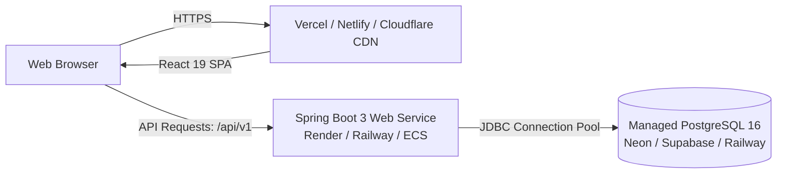

# Production Deployment Guide — JobFit Resume

## 1. Architecture & Deployment Topology



---

## 2. Environment Variables Reference

### 2.1. Backend Environment Variables (`backend`)

| Variable Name | Required | Default Value | Description |
|---|---|---|---|
| `SPRING_PROFILES_ACTIVE` | Yes | `prod` | Activates PostgreSQL datasource config (`application-prod.yml`). |
| `SERVER_PORT` | No | `8080` | Port Spring Boot listens on. |
| `DATABASE_URL` | Yes | `jdbc:postgresql://localhost:5432/jobfit_db` | JDBC connection URL for PostgreSQL. |
| `DATABASE_USERNAME` | Yes | `postgres` | Database username. |
| `DATABASE_PASSWORD` | Yes | — | Database user password. |
| `JWT_SECRET` | Yes | — | Min 64-character hex or Base64 secret key for HMAC-SHA256 tokens. |
| `JWT_EXPIRATION_HOURS` | No | `24` | Token lifespan in hours. |
| `FRONTEND_URL` | No | `http://localhost:5173` | Primary frontend origin for CORS. |
| `CORS_ALLOWED_ORIGINS` | No | `*` | Comma-separated list of allowed web origins. |

### 2.2. Frontend Environment Variables (`frontend`)

| Variable Name | Required | Default Value | Description |
|---|---|---|---|
| `VITE_API_BASE_URL` | Yes | `http://localhost:8080/api/v1` | Root URL of backend API gateway. |

---

## 3. Option A: 1-Click Local or VPS Docker Compose

If running on a VPS (DigitalOcean, Hetzner, AWS EC2, or local workstation with Docker installed):

```bash
# Clone the repository
git clone <repo-url> jobfit-resume
cd jobfit-resume

# Configure secrets
cp .env.example .env
# Edit .env and enter a secure JWT_SECRET and database password

# Spin up all 3 services (PostgreSQL + Spring Boot Backend + Nginx Frontend)
docker compose up -d --build

# Check status
docker compose ps
docker compose logs -f backend
```

Your services will be accessible at:
- **Frontend SPA**: `http://localhost:5173` (or `http://your-server-ip:5173`)
- **Backend REST API**: `http://localhost:8080/api/v1`
- **PostgreSQL Database**: `localhost:5432`

---

## 4. Option B: Cloud PaaS Deployment (Render / Railway / Neon)

### Step 1: Provision Managed PostgreSQL (Neon / Supabase / Railway)
1. Sign up at [Neon.tech](https://neon.tech) or [Supabase.com](https://supabase.com).
2. Create a new PostgreSQL 16 project named `jobfit-resume`.
3. Copy the JDBC connection details:
   - Example JDBC URL: `jdbc:postgresql://ep-example-123456.us-east-2.aws.neon.tech/neondb?sslmode=require`
   - Database User & Password

> [!NOTE]
> Flyway will automatically execute `V1__initial_schema.sql` on the very first boot of the Spring Boot application, initializing all 15 tables and canonical skills without manual SQL execution.

### Step 2: Deploy Backend to Render or Railway
1. Create a new **Web Service** connected to your GitHub repo.
2. Set Root Directory: `backend`.
3. Select **Docker** environment (Render/Railway detects `backend/Dockerfile`).
4. Set Environment Variables:
   - `SPRING_PROFILES_ACTIVE=prod`
   - `DATABASE_URL=jdbc:postgresql://...`
   - `DATABASE_USERNAME=...`
   - `DATABASE_PASSWORD=...`
   - `JWT_SECRET=404E635266556A586E3272357538782F413F4428472B4B6250645367566B5970...`
   - `CORS_ALLOWED_ORIGINS=https://your-frontend.vercel.app`
5. Click **Deploy**. Note your service URL (e.g. `https://jobfit-api.onrender.com`).

### Step 3: Deploy Frontend to Vercel or Netlify
1. Create a new project on [Vercel](https://vercel.com) or [Netlify](https://netlify.com).
2. Set Root Directory: `frontend`.
3. Framework Preset: **Vite**.
4. Build Command: `npm run build`
5. Output Directory: `dist`
6. Add Environment Variable:
   - `VITE_API_BASE_URL=https://jobfit-api.onrender.com/api/v1`
7. Click **Deploy**.

---

## 5. Health Checks & Verification

After deployment, test the backend health and dictionary endpoint:
```bash
curl -I https://jobfit-api.onrender.com/api/v1/skills/dictionary
```
Expected response:
```http
HTTP/1.1 200 OK
Content-Type: application/json
```

Test CORS policy:
```bash
curl -I -X OPTIONS https://jobfit-api.onrender.com/api/v1/profile \
  -H "Origin: https://your-frontend.vercel.app" \
  -H "Access-Control-Request-Method: GET"
```
Expected response:
```http
HTTP/1.1 200 OK
Access-Control-Allow-Origin: https://your-frontend.vercel.app
Access-Control-Allow-Methods: GET, POST, PUT, DELETE, PATCH, OPTIONS
```

---

## 6. Zero-Downtime Migration Strategy

1. **Additive Schema Updates**: When adding columns, always allow `NULL` or provide explicit `DEFAULT` values so legacy backend instances don't fail during rolling updates.
2. **Flyway Locking**: Flyway creates a lock row in `flyway_schema_history` during startup, ensuring only one backend node executes migration scripts at any time.
3. **Database Connection Pooling**: HikariCP handles transient connection drops automatically with `maximumPoolSize: 10`, `minimumIdle: 2`, and `connectionTimeout: 30000`.
