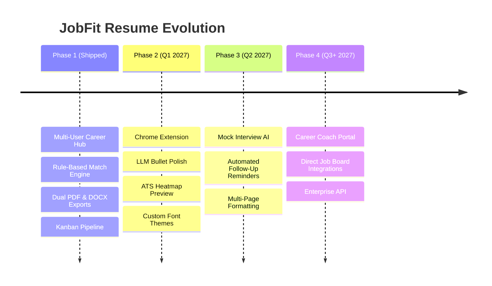

# Product Roadmap & Future Horizons — JobFit Resume

## 1. Vision & Strategic Direction

JobFit Resume empowers job seekers with explainable, deterministic career tools that maximize ATS match rates while preserving absolute truthfulness and professional integrity.

---

## 2. Phase 1: Foundational Platform (Current Release ✅)
- **Multi-Tenant Career Profile Hub**: Single source of truth for work history, education, skills, projects, certifications, and achievements.
- **Rule-Based Match Engine**: Explainable 50/25/15/10 weighted scoring comparing technical skills, years of experience, education degrees, and domain keywords.
- **Curated Skills Gap Roadmap**: Automatic identification of missing skills with official documentation links and targeted practice project ideas.
- **Truth-Preserving Resume Tailor**: Deterministic synthesis of resumes prioritizing relevant projects and skills without fabricating falsehoods.
- **Dual Document Exporters**: Pure Java OpenHTMLtoPDF A4 PDF renderer + native Microsoft Word DOCX generator via Apache POI.
- **Application Tracker**: Interactive Kanban board across 6 application lifecycle stages with conversion analytics.

---

## 3. Phase 2: Near-Term Enhancements (Q1 2027)

### 3.1. Browser Extension (Chrome / Firefox / Edge)
- **1-Click Job Capture**: Clip job descriptions directly from LinkedIn, Indeed, Greenhouse, Lever, and Workday without copy-pasting.
- **Instant Match Indicator**: Floating badge showing candidate match percentage right on the job listing page.
- **One-Click Tailor**: Send job posting to backend and instantly receive tailored resume download link.

### 3.2. LLM-Assisted Bullet Polish (Opt-in)
- **STAR Framework Formatter**: Optional integration with OpenAI / Claude / Gemini API to transform raw bullet points into Situation-Task-Action-Result format.
- **Strict Guardrails**: Prevents the LLM from inventing employers, dates, metrics, or technologies not present in the user's verified career hub.

### 3.3. ATS Keyword Heatmap & Density Inspector
- Real-time side-by-side highlighter in the Resume Builder showing which exact words in the vacancy are present in the resume.
- Over-optimization / keyword stuffing warnings to prevent ATS algorithmic penalties.

---

## 4. Phase 3: Medium-Term Enhancements (Q2 2027)

### 4.1. Personalized Technical Interview Prep
- Generates tailored interview questions based on the candidate's exact project claims and the job's required technologies.
- Behavioral question generator tailored to company culture and role seniority.

### 4.2. Automated Follow-Up Reminders & Notifications
- Recurring cron schedule notifying candidates when applications remain in `APPLIED` status for > 7 days.
- Pre-composed follow-up email templates customized to the hiring manager and company.

### 4.3. Multi-Page Pagination & Custom Styling
- Dynamic 1-page vs 2-page toggle with automatic line-height and margin fitting.
- Custom typography pairings and accent color pickers.

---

## 5. Phase 4: Long-Term Horizons (Q3+ 2027)

### 5.1. Career Coach & University Portal
- Mentor/Coach accounts with granular permissions to review candidate profiles, leave inline comments, and suggest resume revisions.
- Aggregated placement analytics for university career centers and bootcamps.

### 5.2. Direct ATS & Job Board Webhooks
- Webhook subscriptions to receive status updates when a recruiter opens or moves an application forward.
- Direct export to standard JSON Resume format (`jsonresume.org`).
