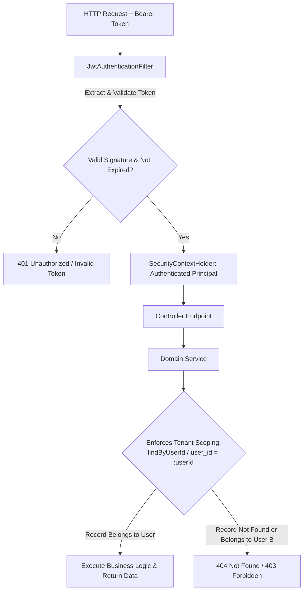

# Security & Multi-Tenant Architecture — JobFit Resume

## 1. Security Architecture Overview

JobFit Resume operates as a multi-user, multi-tenant SaaS application where each user's career records, target job postings, tailored resumes, and pipeline records must be strictly isolated.



---

## 2. Authentication & Credential Storage

### 2.1. Password Hashing (BCrypt)
- User passwords are encrypted using `org.springframework.security.crypto.bcrypt.BCryptPasswordEncoder` with strength 10.
- Raw passwords are never persisted to the database, logged in application outputs, or serialized into JSON payloads (`@JsonProperty(access = WRITE_ONLY)`).

### 2.2. JWT Token Lifecycle
- Tokens are generated using the `io.jsonwebtoken` (JJWT 0.12.6) library.
- **Signing Algorithm**: HMAC using SHA-256 (`Keys.hmacShaKeyFor(secret.getBytes())`).
- **Secret Key**: Must be minimum 256 bits (32 bytes). In production, this is supplied via the `JWT_SECRET` environment variable.
- **Payload Claims**:
  - `sub`: User email address
  - `userId`: User UUID primary key
  - `role`: Spring Security authority (`ROLE_USER`)
  - `iat`: Timestamp issued
  - `exp`: Expiration timestamp (default 24 hours)

### 2.3. Stateless Session Management
- Spring Security is configured with `SessionCreationPolicy.STATELESS`.
- No HTTP sessions or server-side cookies are maintained on the backend, making the service cloud-native and horizontally scalable behind load balancers.

---

## 3. Multi-Tenant Cross-User Isolation Enforcement

A core tenet of JobFit Resume is that **no user can ever view, modify, or delete another user's data**, even if they guess or know the UUID of an object.

### 3.1. Architectural Guarantees
1. **User Identity from Context**: Domain services never trust a `userId` passed as a query parameter or request body. Instead, the authenticated user's ID is retrieved directly from the validated Spring Security context:
   ```java
   UUID currentUserId = SecurityUtils.getCurrentUserId();
   ```
2. **Tenant Scoped Queries**: Repositories enforce queries scoped by tenant ID:
   ```java
   List<Job> findByUserId(UUID userId);
   Optional<Job> findByIdAndUserId(UUID id, UUID userId);
   boolean existsByIdAndUserId(UUID id, UUID userId);
   ```
3. **Automated Security Verification**: The test suite includes dedicated isolation tests (`UserIsolationIntegrationTest.java`) that systematically instantiate User A and User B, verifying that:
   - User B receives `404 Not Found` when trying to fetch User A's jobs, education, or resumes.
   - User B cannot update or delete User A's records.

---

## 4. OWASP Top 10 Mitigation Matrix

| Vulnerability | Mitigation Strategy in JobFit Resume |
|---|---|
| **A01: Broken Access Control** | Strictly scoped JPA repository queries; token claims resolution directly in service layer; automated integration test verification. |
| **A02: Cryptographic Failures** | BCrypt password hashing; HMAC-SHA256 signature verification for tokens; HTTPS enforced in production. |
| **A03: Injection (SQL / Command)** | Spring Data JPA parameterized queries prevent SQL injection; Hibernate handles object-relational mapping without raw string concatenation. |
| **A04: Insecure Design** | Rule-based truth-preserving algorithm prevents artificial hallucination of false employment dates, credentials, or degrees. |
| **A05: Security Misconfiguration** | CORS headers configured explicitly via `CORS_ALLOWED_ORIGINS`; detailed internal stack traces withheld from API error responses. |
| **A06: Vulnerable Components** | Dependencies managed via Maven with automated GitHub Dependabot vulnerability scans; Temurin Alpine base images minimize CVE surface. |
| **A07: Identification & Auth Failures** | Mandatory email uniqueness; minimum password length enforcement; instantaneous token invalidation on secret key rotation. |
| **A08: Software & Data Integrity Failures** | Pure Java document rendering (OpenHTMLtoPDF + Apache POI) without shell execution or unvetted native binaries. |
| **A09: Security Logging & Monitoring** | Audit timestamps (`created_at`, `updated_at`) on all tables; Slf4j structured security event logging. |
| **A10: Server-Side Request Forgery (SSRF)** | External document generation takes only user profile data; no untrusted server-side HTTP fetch calls are made. |

---

## 5. XML & Document Generator Hardening

Because the PDF generation engine (`OpenHTMLtoPDF`) parses XML/XHTML templates:
1. **XML Escaping**: All user-supplied strings (names, companies, summaries, skill badges) are strictly XML-entity escaped (`&` -> `&amp;`, `<` -> `&lt;`, `>` -> `&gt;`, `"` -> `&quot;`).
2. **Entity Resolution**: External DTD resolution and entity expansion (XXE) are disabled by default in the XML reader pipeline.
