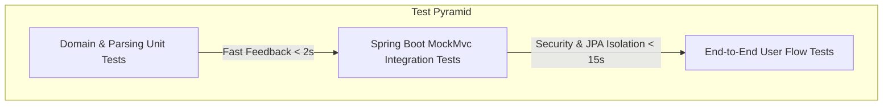

# Testing Strategy & Quality Assurance — JobFit Resume

## 1. Testing Philosophy & Architecture

JobFit Resume maintains a high-bar test pyramid designed to ensure deterministic accuracy, document export validity, and rock-solid multi-tenant security isolation.



---

## 2. Test Suite Breakdown

### 2.1. Backend Unit Tests

#### `JobDescriptionParserTest`
- **Location**: `backend/src/test/java/com/jobfitresume/job/JobDescriptionParserTest.java`
- **Responsibilities**:
  - Validates extraction of required experience years across variations: `"5+ years"`, `"minimum 3 years"`, `"at least 4 yrs"`.
  - Validates education level detection: `"Bachelor's in Computer Science"`, `"M.S. or Ph.D."`.
  - Validates skill alias normalization (e.g. `k8s` -> `kubernetes`, `springboot` -> `spring_boot`).
  - Validates bullet point parsing and splitting across standard formatting markers.

#### `ResumeExportTest`
- **Location**: `backend/src/test/java/com/jobfitresume/resume/ResumeExportTest.java`
- **Responsibilities**:
  - Tests pure Java OpenHTMLtoPDF rendering across all 3 visual templates (`classic`, `modern`, `compact_technical`).
  - Verifies PDF magic bytes (`%PDF-1.4`) and non-empty byte stream generation.
  - Tests native Apache POI DOCX generation, verifying OOXML zip header (`PK\x03\x04`) and valid Word paragraph structures.
  - Validates XML entity escaping to guarantee special characters (`&`, `<`, `>`, `"`) never crash the document rendering pipeline.

---

### 2.2. Backend Integration Tests

#### `AuthIntegrationTest`
- **Location**: `backend/src/test/java/com/jobfitresume/auth/AuthIntegrationTest.java`
- **Responsibilities**:
  - Tests user registration and successful JWT token issuance.
  - Verifies rejection of duplicate email registration (`409 Conflict` or `400 Bad Request`).
  - Tests user authentication with valid and invalid credentials.
  - Verifies that `/api/v1/auth/me` properly extracts user claims from the `Authorization: Bearer` header.

#### `UserIsolationIntegrationTest`
- **Location**: `backend/src/test/java/com/jobfitresume/UserIsolationIntegrationTest.java`
- **Responsibilities**:
  - Spawns two distinct isolated users: `userA` and `userB`.
  - User A creates profile data, jobs, and resumes.
  - Authenticates as User B and attempts to read, modify, and delete User A's entities.
  - Asserts that all unauthorized operations return `404 Not Found` or `403 Forbidden`, guaranteeing zero tenant data leakage.

---

## 3. Running Backend Tests

Run all unit and integration tests locally using Maven:

```bash
cd backend

# Execute entire test suite
mvn test

# Run a specific test class
mvn test -Dtest=ResumeExportTest

# Run with verbose stack traces
mvn test -Dtest=UserIsolationIntegrationTest -e
```

### Expected Output
```text
[INFO] -------------------------------------------------------
[INFO]  T E S T S
[INFO] -------------------------------------------------------
[INFO] Running com.jobfitresume.auth.AuthIntegrationTest
[INFO] Tests run: 2, Failures: 0, Errors: 0, Skipped: 0
[INFO] Running com.jobfitresume.job.JobDescriptionParserTest
[INFO] Tests run: 2, Failures: 0, Errors: 0, Skipped: 0
[INFO] Running com.jobfitresume.resume.ResumeExportTest
[INFO] Tests run: 2, Failures: 0, Errors: 0, Skipped: 0
[INFO] Running com.jobfitresume.UserIsolationIntegrationTest
[INFO] Tests run: 2, Failures: 0, Errors: 0, Skipped: 0
[INFO]
[INFO] Results:
[INFO]
[INFO] Tests run: 8, Failures: 0, Errors: 0, Skipped: 0
[INFO]
[INFO] ------------------------------------------------------------------------
[INFO] BUILD SUCCESS
[INFO] ------------------------------------------------------------------------
```

---

## 4. Frontend Verification & Build Validation

The frontend uses TypeScript strict checking and Vite for bundle generation:

```bash
cd frontend

# Run type check and production bundle build
npm run build

# Run linting
npx oxlint
```

### TypeScript Compliance
- `tsconfig.app.json` has `verbatimModuleSyntax: true` and `noUnusedLocals: true` enabled to prevent runtime circular dependency risks and keep bundle size minimal.

---

## 5. Automated CI/CD Pipeline (GitHub Actions)

Example workflow (`.github/workflows/ci.yml`):

```yaml
name: Continuous Integration

on:
  push:
    branches: [ main ]
  pull_request:
    branches: [ main ]

jobs:
  backend-tests:
    runs-on: ubuntu-latest
    steps:
      - uses: actions/checkout@v4
      - name: Set up JDK 21
        uses: actions/setup-java@v4
        with:
          java-version: '21'
          distribution: 'temurin'
          cache: maven
      - name: Run Maven Tests
        run: cd backend && mvn clean test

  frontend-build:
    runs-on: ubuntu-latest
    steps:
      - uses: actions/checkout@v4
      - name: Set up Node.js
        uses: actions/setup-node@v4
        with:
          node-version: 20
          cache: 'npm'
          cache-dependency-path: frontend/package-lock.json
      - name: Install Dependencies
        run: cd frontend && npm ci
      - name: TypeScript Build
        run: cd frontend && npm run build
```
